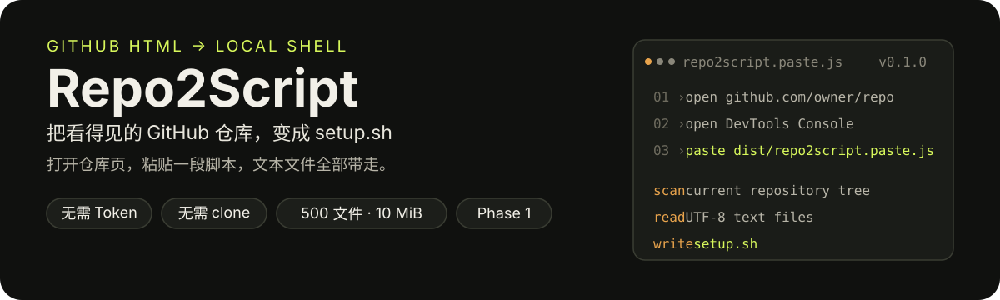
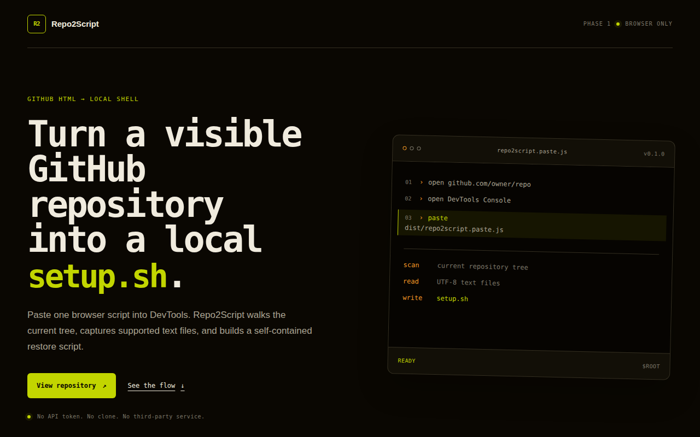

<p align="right"><a href="README.md">中文</a></p>

<p align="center">
  
</p>

<p align="center">
  <a href="https://holynova.github.io/one-punch/">▶ Live Demo</a>
  ·
  <a href="https://github.com/holynova/one-punch">GitHub Repository</a>
</p>

Repo2Script is a browser-only GitHub repository exporter. Open any repository page you can see, paste `dist/repo2script.paste.js` into the DevTools Console, and it walks the current tree, reads the text files, and builds a `setup.sh` that restores the whole project. No GitHub API, no token, no `git clone`, no third-party service.

## Screenshots

<p align="center">
  
</p>

## How to Use

1. **Open**: open the target repository's root page in the browser (any page where the file tree is visible).
2. **Paste**: open the DevTools Console, paste the contents of `dist/repo2script.paste.js`, and run it.
3. **Restore**: copy the generated `setup.sh`, run it in a local folder, and the directories and files are written out as they were.

The generated script only creates directories and writes files; it never executes project code.

## Capabilities & Limits

- **UTF-8 text files only**; binaries, symlinks, submodules, and over-limit content are reported item by item in the result overlay and in the generated script's comments — never silently dropped.
- **Limits** (defaults in code): max 500 files, 2 MiB per text file, 10 MiB total text.
- **Phase 1**: the current version is v0.1.0, with the scope above; see the "Small surface. Clear limits." section on the site for details.

## Development

```bash
npm install
npm test        # Node's built-in test runner (linkedom simulates GitHub pages)
npm run typecheck
npm run build   # esbuild bundles dist/repo2script.paste.js
```

## Tech

- TypeScript + esbuild; tests use Node's built-in `node:test`, with linkedom + local HTML fixtures simulating GitHub tree and blob pages.
- The export script reads the GitHub HTML pages your browser can already see (tree pages, blob pages), not API responses.

```
src/crawler/crawl.ts    Walk the repo tree, read files, enforce limits
src/github/adapter.ts   GitHub page parsing adapter (tree / blob pages)
src/github/identify.ts  Repository URL identification and validation
src/generator/bash.ts   Generate setup.sh (with base64 encoding and delimiters)
src/ui/overlay.ts       In-browser result overlay
dist/repo2script.paste.js   Bundled paste script (build output)
test/                   Core tests + GitHub page fixtures
```
