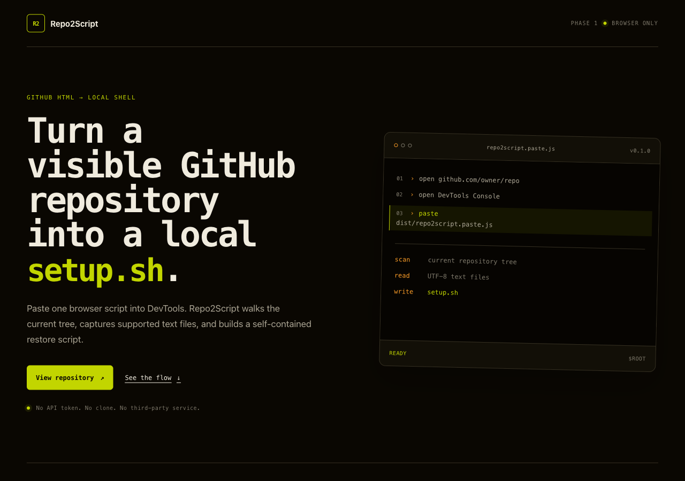

# Repo2Script



Repo2Script 是一个只在浏览器中运行的 GitHub 仓库导出工具。打开仓库页面，把 `dist/repo2script.paste.js` 粘贴到 DevTools Console，它会读取当前可见的文本文件并生成可恢复项目的 `setup.sh`。项目不调用 GitHub API，不需要 Token、`git clone` 或第三方服务。

- [GitHub Repo](https://github.com/holynova/one-punch)
- [GitHub Pages](https://holynova.github.io/one-punch/)

## 本地开发

```sh
pnpm install
pnpm test
pnpm run typecheck
pnpm run build
```

Phase 1 支持 UTF-8 文本文件，并会报告二进制文件、软链接、子模块和超出限制的内容。生成的脚本只创建目录和写入文件，不执行项目代码。
